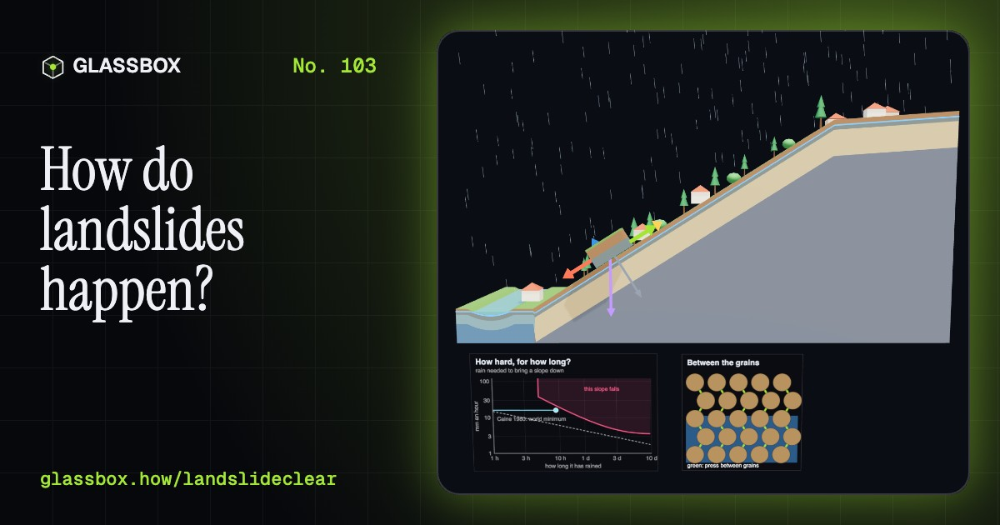
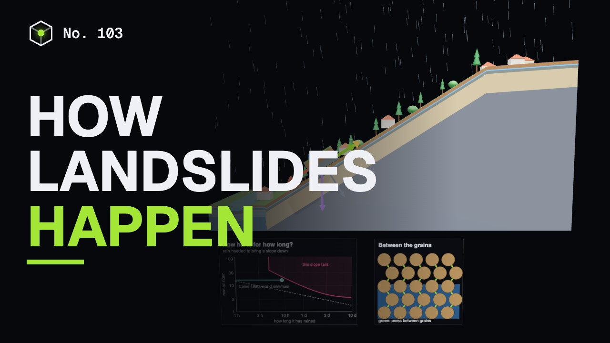
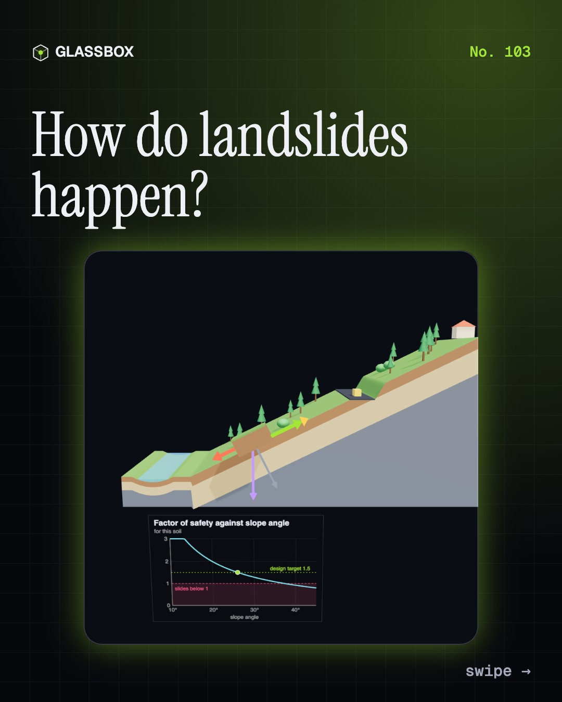
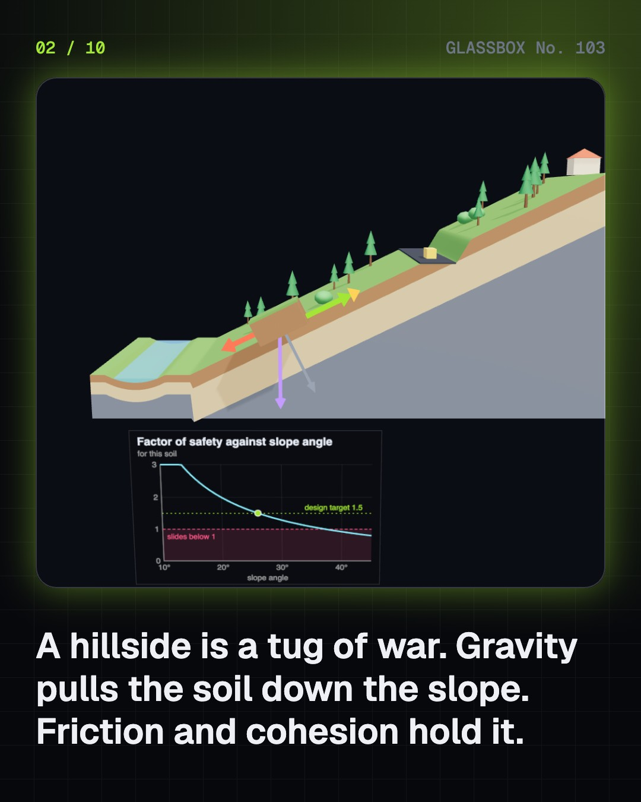
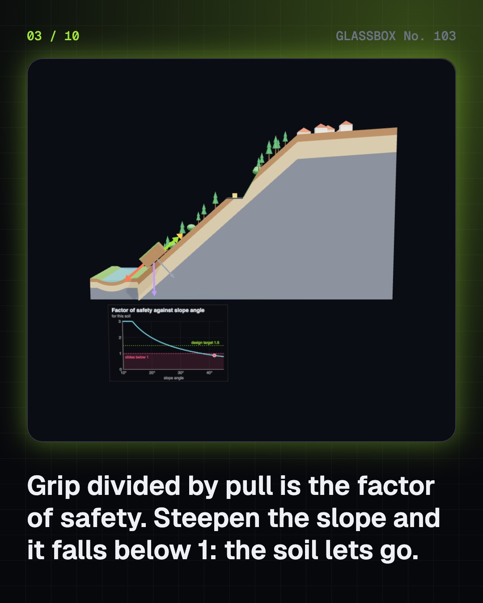
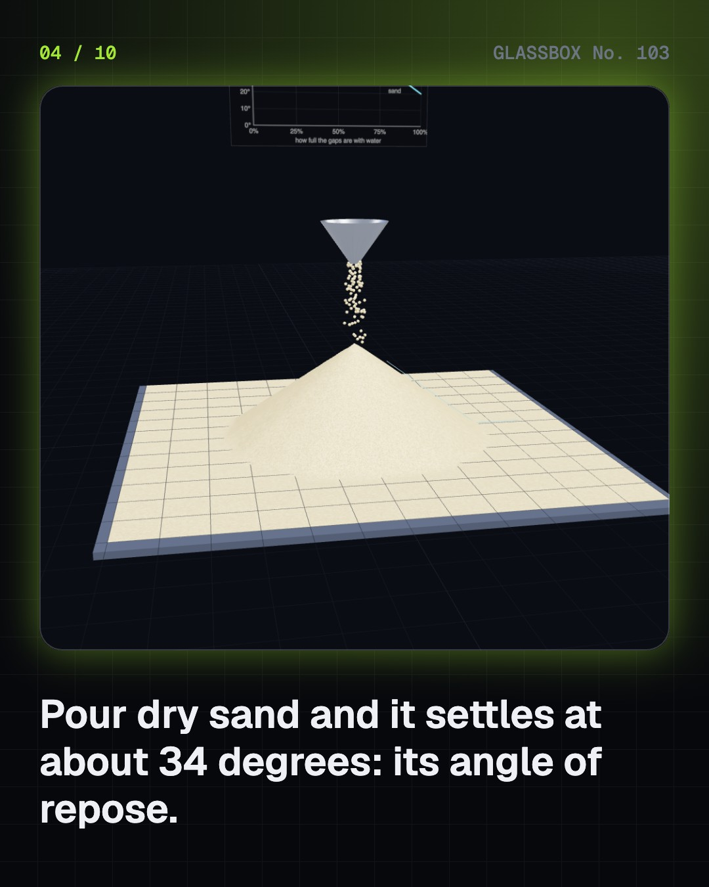

<!-- glassbox:start -->
<!-- Generated from glassbox.json by the Glassbox hub (npm run readme -- landslideclear). Edit glassbox.json, not this block. -->
<p align="center"><a href="https://glassbox.how/e/landslideclear/"></a></p>

<h1 align="center">LandslideClear</h1>

<p align="center"><b>How do landslides happen?</b><br>A hillside is a tug of war that gravity never stops pulling. Friction and cohesion hold the soil, until rain fills the ground, takes the friction away and the slope lets go. Tilt a slope until it fails, pour a sandpile, soak a hill in a cloudburst, switch road cuts, forests and drains on and off, and learn the signs that mean move now.</p>

<p align="center"><a href="https://glassbox.how/landslideclear/"><b>▶ Play with it</b></a> &nbsp;·&nbsp; <a href="https://glassbox.how/e/landslideclear/">Read the 60-second explainer</a> &nbsp;·&nbsp; <a href="https://glassbox.how/landslideclear/glassbox/reel.mp4">Watch the 40-second video</a></p>

<p align="center">
  <a href="https://glassbox.how/e/landslideclear/"></a>
  <a href="https://glassbox.how/e/landslideclear/"></a>
  <a href="LICENSE"></a>
  <a href="LICENSE-CONTENT.md"></a>
  <a href="#privacy"></a>
</p>

## In 60 seconds

1. **A slope in balance.** A block of soil on a slope is pulled downhill by part of its weight and held by friction and cohesion. Coulomb's law of 1776 says strength = cohesion + press × tan φ. Grip divided by pull is the factor of safety: above 1 the slope holds, below 1 it slides. For 3 m of soil with a friction angle of 32° and 5 kPa of cohesion on a 30° slope it is 1.28.
2. **The angle of repose.** Pour dry sand and it settles at about 34°, however big the pile. Angular gravel stands steeper. A little water holds grains together with tiny bridges, which is how a sandcastle stands at 45° or more. Fill every gap with water and the pile slumps to 20° or so.
3. **What rain does.** Rain fills the gaps between soil grains, and the water pressure there carries part of the load. Friction depends only on the press between grains, so it falls while the pull stays the same. This is Terzaghi's effective stress. In the model a steady 8 mm an hour brings the slope down in about 29 hours, and a cloudburst in under 5.
4. **Kinds of landslide.** Rock falls at tens of metres a second. A slump turns slowly on a curved surface. A slab slides on a flat weak layer. A debris flow pours down a gully at 10 m/s and runs far. Creep moves a few millimetres a year and bends trees. From slowest to fastest the range is about a million million to one.
5. **What tips the balance.** Slopes lose safety a piece at a time. Rain, earthquakes and rivers cutting the toe are nature's triggers. Road cuts, quarries, cleared forest and heavy buildings are ours. Drainage, retaining walls, rock bolts and nets, terraces and deep-rooted plants put the safety back. The model finds the weakest slip surface each time you change something.
6. **India's slopes and staying safe.** About 12.6% of India's land outside the snow, 0.42 million km², is landslide-prone: the Himalaya, the North-East and the Western Ghats. Kedarnath 2013, Malin 2014, Kerala 2018 and 2019, Wayanad 2024 and sinking Joshimath are in living memory. New cracks, tilting trees and poles, a spring gone muddy, a rumble: move sideways and uphill, out of the gully, at once. Emergency 112, NDMA 1078.

## Words worth knowing

| Term | Meaning |
|---|---|
| **Factor of safety** | The grip holding a slope divided by the pull trying to move it. Below 1, it slides. |
| **Friction angle** | A measure of how well soil grains lock together. Friction = press × tan φ. |
| **Cohesion** | Strength that does not depend on the press: clay stickiness, cement between grains, roots. |
| **Angle of repose** | The steepest angle at which a heap of loose grains will stand, about 34° for dry sand. |
| **Pore-water pressure** | The pressure of water in the gaps between soil grains. It pushes the grains apart. |
| **Effective stress** | The press carried grain to grain: the total press minus the water pressure. Friction depends on it. |
| **Debris flow** | A fast flow of water mixed with soil, rock and wood, usually along a gully. |
| **Rainfall threshold** | The mix of rain intensity and duration above which landslides become likely. |
| **Slip surface** | The surface inside the ground on which a sliding mass moves. |

## A short history

**From Coulomb's friction and cohesion to a daily landslide forecast: how people learned why slopes fail, and how to get out of the way.**

- **1773** · Coulomb: friction and cohesion (Charles-Augustin de Coulomb, Paris)
- **1925** · Terzaghi: water carries part of the load (Karl Terzaghi, Istanbul and Vienna)
- **1963** · The Vaiont dam disaster
- **1978** · Varnes names the kinds of landslide (David J. Varnes, US Geological Survey, Denver)
- **1980** · Caine's rainfall threshold (Nel Caine, University of Colorado)
- **2004** · GSI becomes India's nodal agency for landslides (Geological Survey of India, Kolkata)
- **2013** · Kedarnath and the Uttarakhand floods
- **2014** · Malin

The full story, with 28 moments, charts, people and 63 sources: [glassbox.how/e/landslideclear/history](https://glassbox.how/e/landslideclear/history/). The data lives in [`history.json`](history.json).

## Video and slides

Made with the Glassbox studio from this box's storyboard (`window.glassbox.director`). Free to reuse under CC BY 4.0.

<a href="https://glassbox.how/landslideclear/glassbox/video.mp4"></a>

<p><a href="glassbox/slide-1.jpg"></a> <a href="glassbox/slide-2.jpg"></a> <a href="glassbox/slide-3.jpg"></a> <a href="glassbox/slide-4.jpg"></a></p>

| File | What | Size |
|---|---|---|
| [`glassbox/reel.mp4`](https://glassbox.how/landslideclear/glassbox/reel.mp4) | Reel / Short, with captions and soundtrack | 1080×1920 |
| [`glassbox/video.mp4`](https://glassbox.how/landslideclear/glassbox/video.mp4) | YouTube video, with captions and soundtrack | 1920×1080 |
| `glassbox/slide-1…10.jpg` | Instagram carousel | 1080×1350 |
| `glassbox/thumb.jpg` | YouTube thumbnail | 1280×720 |
| `glassbox/cover.jpg` | Share card and repo social preview | 1200×630 |
| [`glassbox/history-reel.mp4`](https://glassbox.how/landslideclear/glassbox/history-reel.mp4) | “History in 10 moments” Reel / Short | 1080×1920 |
| `glassbox/history-slide-*.jpg` | History carousel | 1080×1350 |
| `glassbox/post.json` | Post copy and schedule used by the publish kit | |

## Privacy

This box has no accounts and no ads, and it ships its own fonts and libraries. When you run it yourself it sends nothing anywhere. On glassbox.how, the site's `/bar.js` also loads Glassbox's analytics: **Google Analytics** to count visits (it asks first in the EU, UK and Switzerland, and stays off when your browser sends Global Privacy Control or Do Not Track) and **ClickTrust** to detect bots.

It remembers a few things **in your own browser only**, and never sends them anywhere:

| Browser storage key | What it holds |
|---|---|
| `landslideclear.v1` | Which chapters you have opened, your best quiz scores, and sound on or off. |

Exactly what each one sees is at [glassbox.how/privacy](https://glassbox.how/privacy/).

## Licences

- **Code:** [MIT](LICENSE). Use it, change it, ship it.
- **Explanations, text, images and videos** (`glassbox.json`, `glassbox/`): [CC BY 4.0](LICENSE-CONTENT.md). Credit “Glassbox, glassbox.how/e/landslideclear”.
- **Third-party parts** keep their own licences: [three.js](https://threejs.org) (MIT), [Geist, Instrument Serif](https://openfontlicense.org) (SIL OFL 1.1).
- The Glassbox name and logo aren't covered by either licence. See the [terms](https://glassbox.how/terms/).

Found a mistake? [Open an issue](https://github.com/bdeeps/landslideclear/issues). Corrections happen in public.
<!-- glassbox:end -->

## Run it

It's plain HTML, CSS and JavaScript. No build step and no dependencies. Run locally, it contacts no other website.

```bash
python3 -m http.server 8000
```

Three.js and the fonts ship in `vendor/` and `fonts/`, so it also works offline.

Then open http://localhost:8000.

## How it's built

| File | What |
|---|---|
| `index.html`, `css/app.css` | The page and its styles |
| `js/app.js`, `js/stage.js`, `js/ui.js`, `js/kit.js` | The shared Glassbox 3D engine: chapters, 3D stage, controls, quiz, video director |
| `js/chapters/*.js` | One file per chapter: the 3D model, controls, text, key terms, quiz and video scenes |
| `js/soil.js` | LandslideClear's physics, with no 3D in it: the infinite-slope factor of safety with pore-water pressure and a sideways earthquake force, the ordinary method of slices with a search for the weakest slip circle, a one-bucket model of rain soaking in, Caine's rainfall threshold, and the Cruden and Varnes speed scale |
| `js/slope.js` | Shared 3D parts: the cutaway hillside drawn from the section in `soil.js` (soil, weathered rock, bedrock, water table, slip surface, sliding debris), the block of soil with its force arrows, rain, houses and trees, and chart boards |
| `glassbox.json` | Title, question, explainer beats, key terms, browser storage and credits shown on glassbox.how |
| `reel` in each chapter | The storyboard the Glassbox studio records into short videos |
| `glassbox/` | The published video, slides, thumbnail and post copy |
| `fonts/`, `vendor/three/` | Self-hosted Geist and Instrument Serif (SIL OFL 1.1) and three.js (MIT) |
